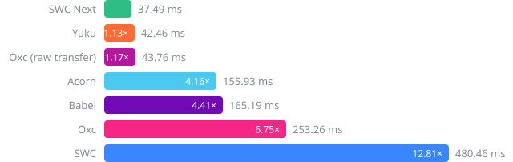
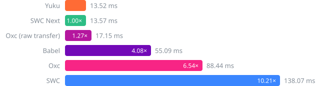
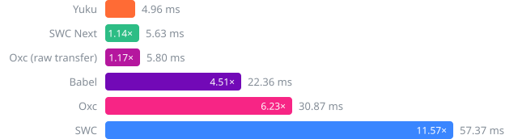
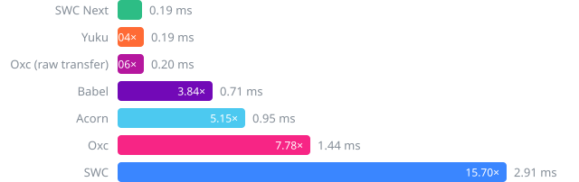

# ECMAScript Parser Benchmark (npm)

This repository is a fork of [yuku-toolchain/ecmascript-parser-benchmark-native](https://github.com/yuku-toolchain/ecmascript-parser-benchmark-native), maintained to update parser benchmark data and add parsers.

Benchmarks for ECMAScript parsers available as npm packages, including pure JavaScript parsers and native parsers (Zig, Rust).

## System

| Property | Value |
|----------|-------|
| OS | macOS 25.6.0 (arm64) |
| CPU | Apple M5 Max |
| Cores | 18 |
| Memory | 64 GB |
| Runtime | Node.js v24.20.0 |

## Parsers

### [Acorn](https://github.com/acornjs/acorn)

A tiny, fast JavaScript parser, written completely in JavaScript.

### [Babel](https://github.com/babel/babel/tree/main/packages/babel-parser)

A JavaScript compiler and parser used by the Babel toolchain.

### [Oxc](https://github.com/oxc-project/oxc)

A high-performance JavaScript and TypeScript parser written in Rust.

### [Oxc (raw transfer)](https://github.com/oxc-project/oxc)

The native Oxc parser with experimental raw AST transfer enabled.

### [SWC](https://github.com/swc-project/swc)

An extensible Rust-based platform for compiling and bundling JavaScript and TypeScript.

### [SWC Next](https://github.com/swc-project/swc-next)

The next-generation SWC JavaScript and TypeScript parser.

### [Yuku](https://github.com/yuku-toolchain/yuku)

A high-performance & spec-compliant JavaScript/TypeScript compiler written in Zig.

## Benchmarks

### [typescript.js](https://raw.githubusercontent.com/yuku-toolchain/parser-benchmark-files/refs/heads/main/typescript.js)

**File size:** 7.83 MB



| Parser | Median | RME | Mean | Min | Max | Ops/sec | Relative |
|--------|--------|-----|------|-----|-----|---------|----------|
| **SWC Next** | **37.49 ms** | **±3.03%** | **43.02 ms** | **30.97 ms** | **74.15 ms** | **26.67 ops/s** | **baseline** |
| Yuku | 42.46 ms | ±2.23% | 46.37 ms | 38.33 ms | 63.03 ms | 23.55 ops/s | 1.13× slower |
| Oxc (raw transfer) | 43.76 ms | ±2.09% | 44.49 ms | 32.39 ms | 81.18 ms | 22.85 ops/s | 1.17× slower |
| Acorn | 155.93 ms | ±1.59% | 158.26 ms | 146.17 ms | 212.37 ms | 6.41 ops/s | 4.16× slower |
| Babel | 165.19 ms | ±2.91% | 170.67 ms | 151.02 ms | 269.13 ms | 6.05 ops/s | 4.41× slower |
| Oxc | 253.26 ms | ±2.13% | 263.28 ms | 240.21 ms | 342.63 ms | 3.95 ops/s | 6.75× slower |
| SWC | 480.46 ms | ±1.53% | 490.91 ms | 459.44 ms | 691.92 ms | 2.08 ops/s | 12.81× slower |

### [checker.ts](https://raw.githubusercontent.com/yuku-toolchain/parser-benchmark-files/refs/heads/main/checker.ts)

**File size:** 2.95 MB



| Parser | Median | RME | Mean | Min | Max | Ops/sec | Relative |
|--------|--------|-----|------|-----|-----|---------|----------|
| **Yuku** | **13.52 ms** | **±1.48%** | **14.91 ms** | **11.52 ms** | **37.04 ms** | **73.98 ops/s** | **baseline** |
| SWC Next | 13.57 ms | ±2.82% | 16.36 ms | 12.23 ms | 45.71 ms | 73.71 ops/s | 1.00× slower |
| Oxc (raw transfer) | 17.15 ms | ±3.41% | 20.86 ms | 15.12 ms | 96.76 ms | 58.30 ops/s | 1.27× slower |
| Babel | 55.09 ms | ±1.31% | 56.18 ms | 50.46 ms | 82.75 ms | 18.15 ops/s | 4.08× slower |
| Oxc | 88.44 ms | ±1.55% | 86.83 ms | 76.24 ms | 142.86 ms | 11.31 ops/s | 6.54× slower |
| SWC | 138.07 ms | ±0.59% | 139.72 ms | 134.19 ms | 162.59 ms | 7.24 ops/s | 10.21× slower |
| Acorn | Failed to parse | - | - | - | - | - | - |

### [lib.dom.d.ts](https://raw.githubusercontent.com/yuku-toolchain/parser-benchmark-files/refs/heads/main/lib.dom.d.ts)

**File size:** 2.24 MB



| Parser | Median | RME | Mean | Min | Max | Ops/sec | Relative |
|--------|--------|-----|------|-----|-----|---------|----------|
| **Yuku** | **4.96 ms** | **±0.97%** | **5.46 ms** | **4.61 ms** | **14.86 ms** | **201.68 ops/s** | **baseline** |
| SWC Next | 5.63 ms | ±0.84% | 5.99 ms | 5.06 ms | 20.70 ms | 177.62 ops/s | 1.14× slower |
| Oxc (raw transfer) | 5.80 ms | ±2.41% | 7.71 ms | 5.31 ms | 37.84 ms | 172.40 ops/s | 1.17× slower |
| Babel | 22.36 ms | ±0.83% | 22.76 ms | 20.22 ms | 40.43 ms | 44.73 ops/s | 4.51× slower |
| Oxc | 30.87 ms | ±1.68% | 33.24 ms | 29.60 ms | 57.64 ms | 32.39 ops/s | 6.23× slower |
| SWC | 57.37 ms | ±0.55% | 57.78 ms | 55.16 ms | 87.30 ms | 17.43 ops/s | 11.57× slower |
| Acorn | Failed to parse | - | - | - | - | - | - |

### [react.js](https://raw.githubusercontent.com/yuku-toolchain/parser-benchmark-files/refs/heads/main/react.js)

**File size:** 0.07 MB



| Parser | Median | RME | Mean | Min | Max | Ops/sec | Relative |
|--------|--------|-----|------|-----|-----|---------|----------|
| **SWC Next** | **0.19 ms** | **±0.65%** | **0.21 ms** | **0.15 ms** | **11.76 ms** | **5398.11 ops/s** | **baseline** |
| Yuku | 0.19 ms | ±0.14% | 0.20 ms | 0.18 ms | 3.27 ms | 5180.22 ops/s | 1.04× slower |
| Oxc (raw transfer) | 0.20 ms | ±4.98% | 0.37 ms | 0.17 ms | 26.01 ms | 5109.63 ops/s | 1.06× slower |
| Babel | 0.71 ms | ±0.22% | 0.74 ms | 0.67 ms | 3.23 ms | 1406.88 ops/s | 3.84× slower |
| Acorn | 0.95 ms | ±0.19% | 0.97 ms | 0.90 ms | 16.74 ms | 1049.00 ops/s | 5.15× slower |
| Oxc | 1.44 ms | ±1.75% | 1.60 ms | 1.35 ms | 18.22 ms | 693.84 ops/s | 7.78× slower |
| SWC | 2.91 ms | ±0.30% | 2.98 ms | 2.70 ms | 6.78 ms | 343.78 ops/s | 15.70× slower |

## Run Benchmarks

### Prerequisites

- [Node.js 22.18 or later](https://nodejs.org/) - Benchmark runtime
- [pnpm](https://pnpm.io/) - Package manager

### Steps

1. Clone the repository:

```bash
git clone https://github.com/rstackjs/ecmascript-parser-benchmark-js.git
cd ecmascript-parser-benchmark-js
```

2. Install dependencies:

```bash
pnpm install
```

3. Download the benchmark files:

```bash
pnpm run load-files
```

4. Run benchmarks:

```bash
pnpm bench
```

This will run benchmarks on all test files. Results are saved to the `result/` directory.

Benchmark duration is configurable via the environment variables `BENCH_TIME` (timed duration per run in ms, default 10000), `BENCH_WARMUP` (warmup duration in ms, default 2000), and `BENCH_RUNS` (independent runs per parser, default 3). For the most stable numbers, run on AC power with no other applications running.

## Methodology

Each parser is benchmarked using [Tinybench](https://github.com/tinylibs/tinybench) with warmup iterations followed by multiple timed runs. Each run measures the time to parse the source text into an AST. Source files are read from disk once and kept in memory for all iterations.

To keep results stable and fair, every parser × file combination runs in its own freshly spawned process, so JIT state and GC pressure from one parser never affect another. Each combination is benchmarked in multiple independent runs (3 by default), and the reported median is the median across those runs, a statistic that is robust to GC pauses, OS scheduling blips, and other outliers. The RME column shows the relative margin of error (99% confidence) within a run. Differences between parsers smaller than their combined margins should be treated as noise.

Native parsers (Oxc, SWC, SWC Next, Yuku) run through their respective bindings, so measured time includes the binding overhead. Pure JS parsers (Acorn, Babel) run directly in the JavaScript runtime.

`lib.dom.d.ts` is a global declaration script with no imports or exports. SWC parses it as a script rather than a module, because its npm binding otherwise rejects the file's `...arguments` parameter names under module strict mode.
